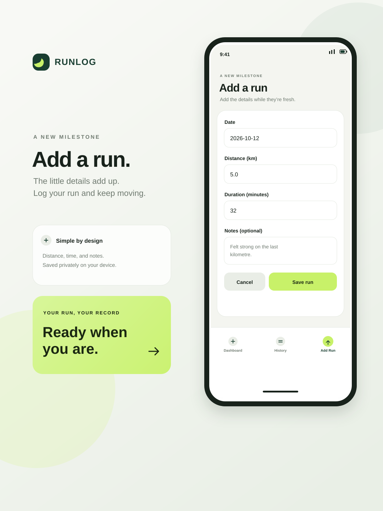
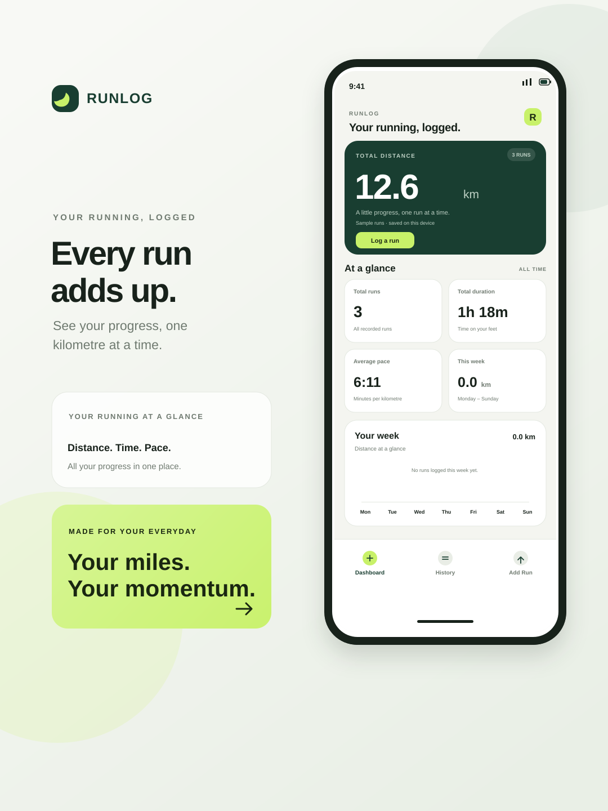

# RunLog

RunLog is a personal running tracker built with Expo, React Native, and JavaScript. It records runs on-device and summarizes distance, duration, average pace, and weekly distance.

## Features

- Dashboard totals and a Monday–Sunday distance chart.
- Add, edit, and delete runs with date, distance in kilometres, duration in minutes, and optional notes.
- Inline form validation, loading and storage-error states, and confirmation before deleting.
- Local persistence with AsyncStorage; no account, backend, GPS tracking, or paid service.

## Add Run screen showcase



## Dashboard showcase



## Add Run screen

Choose **Add Run** in the app navigation to open the run form. Enter:

- **Date** in `YYYY-MM-DD` format (defaults to today).
- **Distance** in kilometres.
- **Duration** in minutes.
- **Notes** (optional), such as how the run felt.

The date must be a real calendar date, and distance and duration must be greater than zero. Validation messages appear beside fields that need attention. Choose **Save run** to save the entry on this device, or **Cancel** to leave without saving. To edit a saved run, open it from Running History; the form is prefilled and the button reads **Save changes**.

## Run the app

Install dependencies and start Expo:

```bash
npm install
npm run start
```

Open the app on an Android device or emulator using the Expo CLI prompts. An Android development environment is required for emulator/device workflows. Expo Go can be used where its bundled native modules support the installed SDK.

## Build an installable Android APK

An internal APK can be built with EAS Build:

```bash
npx eas-cli login
npx eas-cli build --platform android --profile preview
```

Download the APK from the build link EAS prints when the build finishes, copy it to an Android device, and install it. The APK bundles the app, so using RunLog after installation does not require an internet connection. EAS Build requires an Expo account and internet access to create the build.

## Local data and sample runs

Sample records in `src/data/runs.json` are copied into AsyncStorage only when the RunLog storage key is absent on first launch. Existing records are not replaced with samples. Runs remain on the device under the versioned `@runlog/runs:v1` key; unreadable or invalid stored data is reported instead of silently reset.

## Checks

```bash
npm run lint
npx tsc --noEmit
```

The app implementation is JavaScript-based. The TypeScript command checks the existing project configuration and types.
